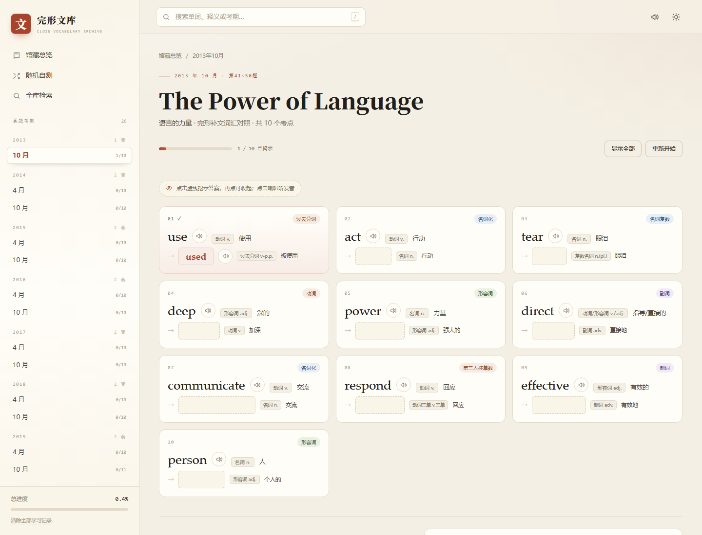
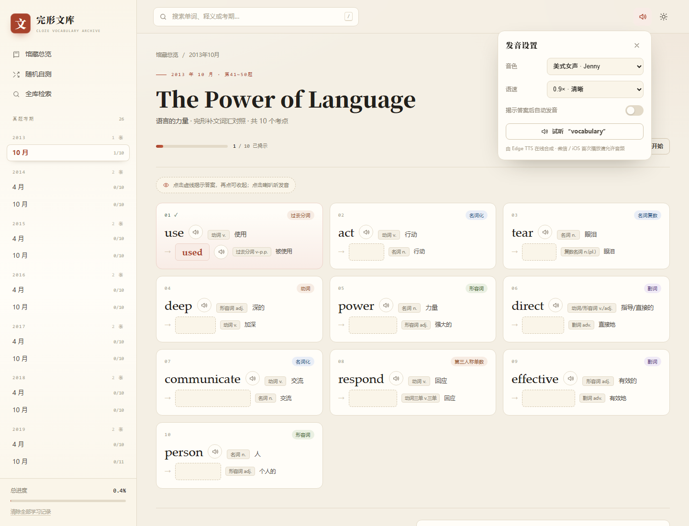

# 真题完形补文词汇文库

自考英语（专升本）历年真题「完形补文」词汇对照的在线知识库。

源文档中所有以 **【】** 标注的答案词，在本站中都被处理为**挖空**：只有点击虚线位置，才会显示答案。每个原词与答案词都配有 Edge TTS 在线发音，手机与微信内均可使用。纯静态站点，无框架、无构建步骤，可直接部署到 GitHub Pages。




## 功能

- **点击揭示**：每个考点答案默认隐藏，点击挖空处显示；再次点击可收起。键盘 `Tab` + `Enter` / `Space` 同样可用。
- **单词发音**：原词与答案词均配有喇叭按钮，调用 Edge TTS 在线合成；支持 6 种英文音色、4 档语速，可开启「揭示答案后自动发音」。
- **全库检索**：支持英文原词、答案、词性、中文释义、考期与变化类型（如「过去分词」「名词化」「否定前缀」）；输入时可即时预览结果。
- **随机自测**：从 261 个考点中随机抽题，先回想再揭示，可连续刷题。
- **学习进度**：按试卷记录已揭示数量，总进度显示在侧栏，保存在浏览器 `localStorage`，不上传服务器；支持单卷重来与全部清除。
- **深色模式 / 响应式布局 / 微信 H5 适配 / 打印样式**。

## 目录结构

```
.
├── index.html                 # 站点入口
├── assets/
│   ├── css/main.css           # 样式
│   ├── js/app.js              # 交互逻辑（路由、检索、自测、进度、TTS）
│   ├── js/data.js             # 由 DOCX 生成的题库数据
│   └── favicon.svg
├── source/
│   └── 真题完形补文词汇总表.docx   # 原始文档（数据源）
├── scripts/
│   └── build_data.py          # DOCX → assets/js/data.js
├── preview-home.png
├── preview-paper.png
├── preview-voice.png
├── .nojekyll                  # 让 GitHub Pages 跳过 Jekyll
└── README.md
```

## 本地预览

直接双击 `index.html` 即可（数据以 `data.js` 形式加载，`file://` 下也能运行）。

也可以起一个本地静态服务器：

```bash
python -m http.server 8000
# 打开 http://localhost:8000
```

## 部署到 GitHub Pages

在项目目录执行：

```bash
git init
git add .
git commit -m "feat: 真题完形补文词汇文库"
git branch -M main
git remote add origin https://github.com/<你的用户名>/<仓库名>.git
git push -u origin main
```

然后进入仓库 **Settings → Pages**：

- Source 选择 **Deploy from a branch**
- Branch 选择 **main**，目录选择 **/ (root)**
- 保存后等待 1～2 分钟

访问地址：`https://<你的用户名>.github.io/<仓库名>/`

> 仓库名若为 `<用户名>.github.io`，地址则是 `https://<用户名>.github.io/`。

本站是纯静态页面，无需 Actions、无需构建。`.nojekyll` 已包含，避免下划线文件被 Jekyll 忽略。

也可以部署到 Gitee Pages、Cloudflare Pages、Netlify、Vercel 等任意静态托管：构建命令留空，发布目录选择仓库根目录即可。

## 单词发音（Edge TTS）



页面右上角的喇叭按钮打开「发音设置」：

- **音色**：Jenny / Aria / Guy / Sonia / Ryan / Natasha（美式、英式、澳式）
- **语速**：0.8× / 0.9× / 1.0× / 1.1×，默认 0.9×
- **揭示答案后自动发音**：默认关闭，开启后点击挖空会同时朗读答案
- **试听**：使用当前音色与语速播放 “vocabulary”

接口地址写在 [assets/js/app.js](assets/js/app.js) 的 `TTS_URL` 中：

```js
const TTS_URL = "https://api.xiemojy.mom/v1/audio/speech";
```

如你的 Worker 设置了 `API_KEY`，把 `TTS_API_KEY` 常量填上即可（请求头使用 `x-api-key`，与 Worker 的 CORS 配置一致；注意前端代码是公开的，只能起到访问控制作用，不能真正保密）。

实现细节：

- 音频按「音色 + 语速 + 单词」缓存在内存中，同一单词重复点击不会重复请求；最多缓存 160 条。
- 页面首次触摸/点击时用静音音频解锁 iOS / 微信的音频权限；播放失败会提示「请再点一次喇叭」。
- 每次只播放一个单词，点击另一个喇叭会自动停止上一个。
- 离开当前页面、试卷重来或切换音色/语速时会停止播放。

> 发音需要联网。微信内置浏览器与 iOS Safari 首次播放必须由用户点击触发；若遇到无声，再点一次喇叭即可。

## 微信 / 手机适配

- 顶部安全区适配 iPhone 刘海与底部 Home 条（`safe-area-inset-*`）。
- 搜索框、音色下拉在移动端使用 16px 字号，避免 iOS 聚焦时自动放大页面。
- 触摸按钮统一 `touch-action: manipulation`，并禁用双击缩放与长按菜单。
- 侧栏在手机上为抽屉式，点击遮罩或按 `Esc` 关闭。
- 微信内使用同一个 `<audio>` 元素并 `playsinline`，避免 iOS 全屏接管。

## 更新题库

1. 用新的 Word 文档替换 `source/` 下的源文件（保持同样的结构：`==== 2025年10月 ====` 考期行、试卷标题行、`原词（词性）释义 → 【答案】（词性）释义` 词条行）。
2. 运行生成脚本（需要 Python 与 `python-docx`）：

```bash
python scripts/build_data.py
# 或指定文档路径
python scripts/build_data.py "source/真题完形补文词汇总表.docx"
```

脚本会重新生成 `assets/js/data.js`，并打印解析到的考期数、考点数以及无法解析的行（`WARN`）。确认无误后提交并推送即可。

不带参数时优先读取 `source/` 下的源文件，找不到再回退到桌面路径；也可以随时用命令行参数指定。

## 数据说明

- 收录 26 个考期（2013 年 10 月 — 2026 年 4 月），共 261 个考点。
- 每个考点保留：原词、原词词性、中文释义、答案词、答案词性、答案释义、变化类型标签。
- 变化类型标签由答案词性自动推导（过去分词、名词化、副词、比较级、否定前缀等）。
- 2018 年 10 月为《Keeping Friendship Alive》，与 2018 年 4 月的《Workplace English Learning》为两套不同内容。
- 2018 年 10 月按原文 41–50 题提取；文首 `(friend)` 是示例（`friends` 已给出），不计入 10 个考点。

## 说明

- 学习进度为浏览器本地数据，换设备或清除缓存后不会保留；「重新开始」只清除当前试卷，「清除全部学习记录」会清零所有进度。
- 2018 年 10 月的题目已更正，站点首次加载新版本时会清空该卷旧进度，其他试卷进度不受影响。
- 文字内容可离线浏览；单词发音由 Edge TTS 在线合成，需要联网，接口不可用时会以提示条告知。
- 页面无第三方统计、无外部字体请求。
- 建议使用较新的 Chrome / Edge / Safari / Firefox；微信内置浏览器可直接打开。
